<div align="center">


### A 3D maze chase where every single pixel is drawn in code.

Guide a hungry beagle through the maze, eat every biscuit, and chomp the bone to turn the tables.

<a href="https://beaglechomp.nunoamorim.dev"></a>

<sub>Works on phones, tablets and desktops · install it to your home screen like an app · no download store needed</sub>

<br><br>

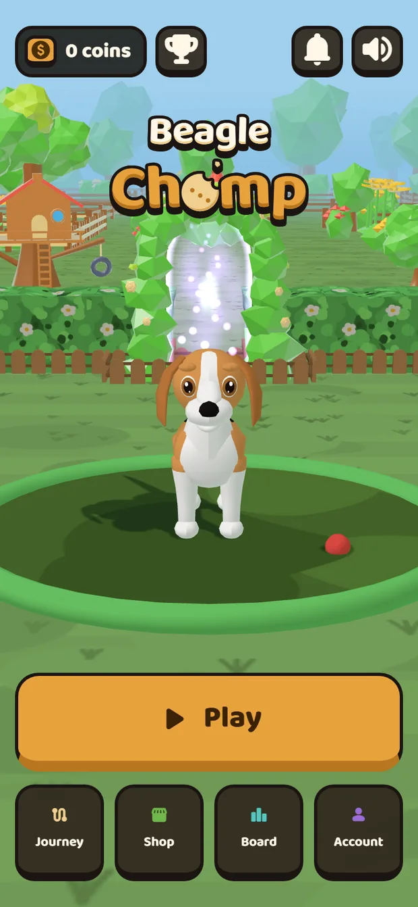
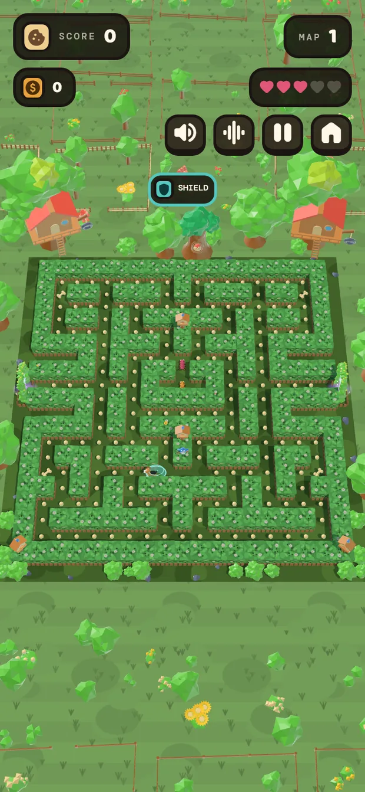
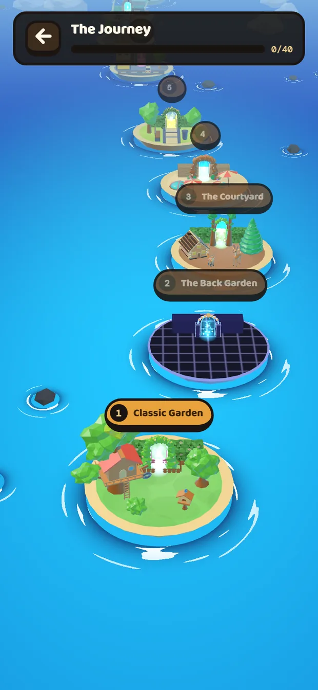
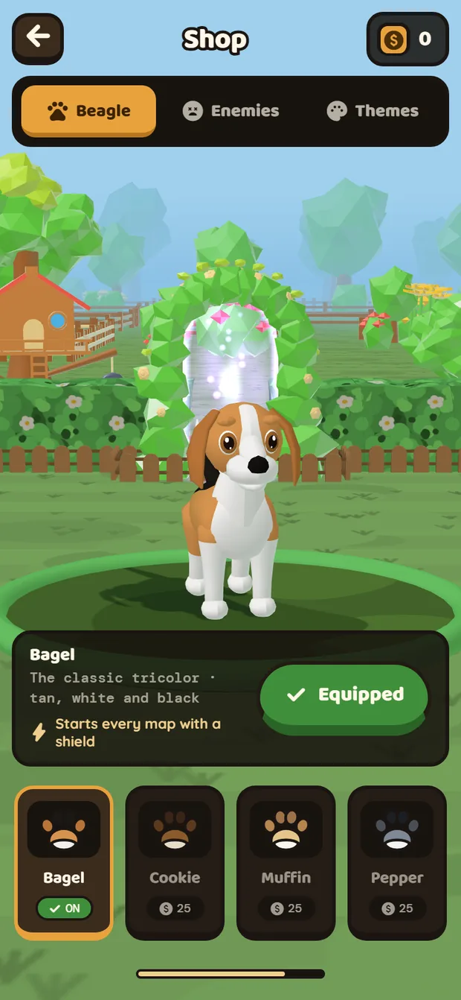

</div>

---

## How to play

**Eat every biscuit to clear the map.** The bugs (and, later, a walking pizza slice) are
chasing you. Grab the **golden bone** and the tables turn: for a few seconds they are
scared, and you can chomp them for big points.

- 🍪 **Biscuits** clear the board. Eat them all to move on to the next map.
- 🦴 **The bone** makes every enemy edible for a short while.
- 🍎 **Fruit** appears for a limited time. The rarer the fruit, the more it's worth (100 up to 500).
- 🪙 **Coins** are hidden on every map. Spend them in the shop on new beagles, enemies and worlds.
- ⭐ **Power-ups** change the rules: double points, a star, an anchor that slows the pack,
  and a **shield** that lets you survive one hit.

**Controls:** swipe, a thumbstick or an on-screen D-pad on touch screens (your pick, in
Account), and the arrow keys or **WASD** on a keyboard.

## What's inside

| | |
|---|---|
| 🗺️ **36 mazes** | An endless **Classic** mode of 30-map cycles in six stages, each closed by a bonus level. |
| 🏝️ **The Journey** | 40 hand-tuned levels: a grand tour of every maze, then ten that bend the rules. |
| 🏆 **114 challenges** | Goals with coin rewards, like *"collect 30 bones in one run"*. Your progress fills in from games you have already played. |
| 🐶 **5 beagles, each with a power** | A shield every map, an extra life, double coins, bonus fruit… the shop sells *dogs*, not skins. |
| 🐛 **11 enemies** | From a flea and a crab to sushi, a pizza slice and a stacked hamburger. |
| 🌍 **8 worlds** | A garden, a deep forest, a beach, a park, two cities, a pirate island, and a neon arcade throwback. |
| 🔊 **A sound for every world** | Birdsong, surf, forest wind, distant traffic: generated live, never a recording. |
| 📊 **A real leaderboard** | Every score is checked by the server against what the game can actually produce. |

### Eight worlds to play in

<div align="center">
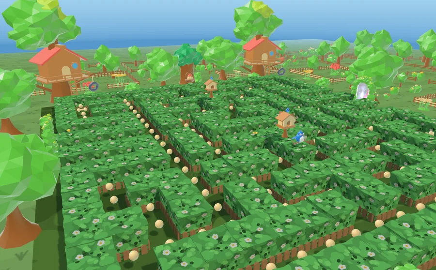
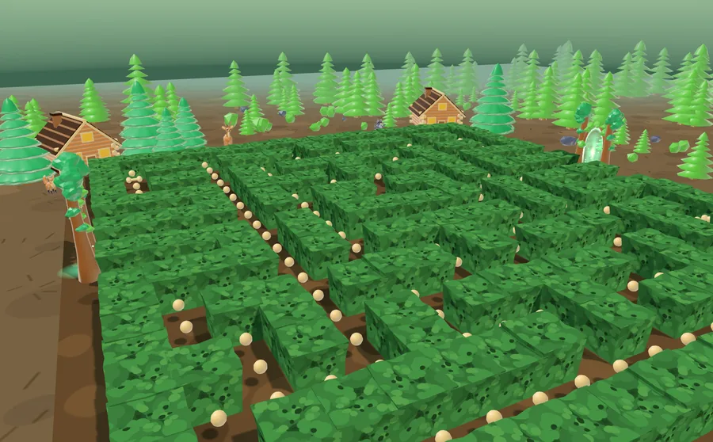
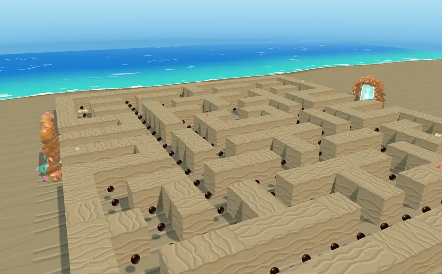
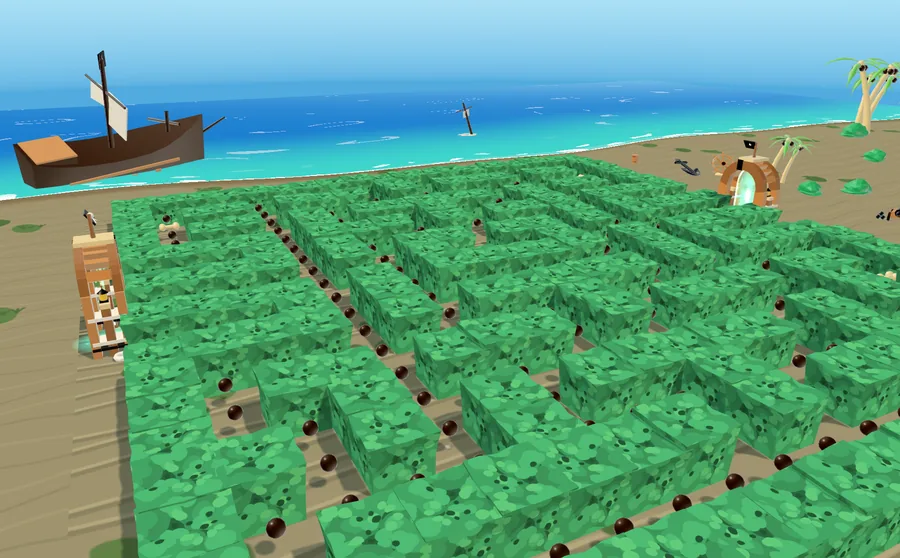
<br>
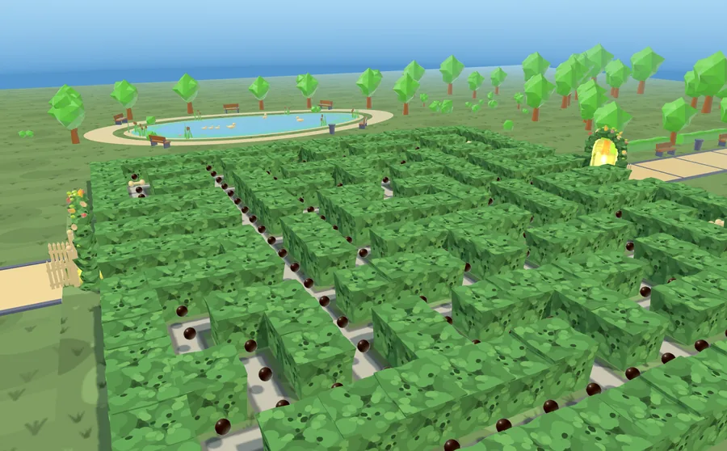
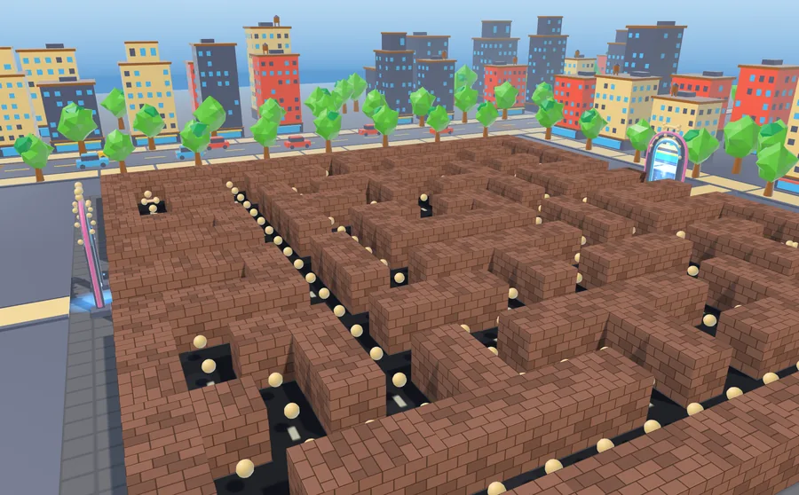
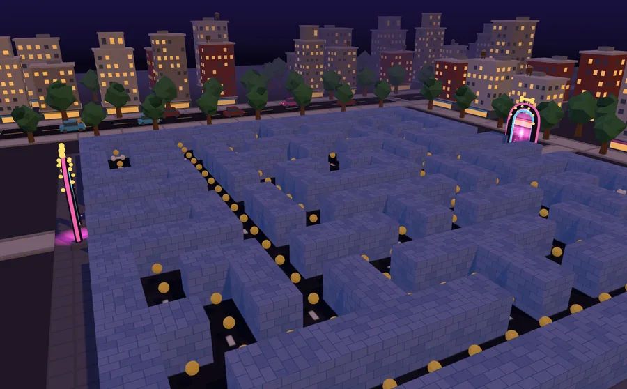
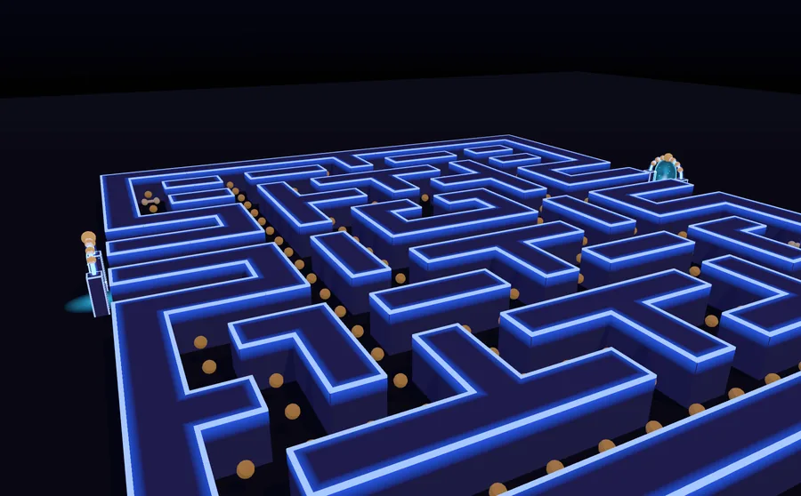
</div>

<div align="center"><sub>The Garden · Deep Forest · Sunny Beach · Pirate Island · City Park · Day City · Night City · Arcade Night</sub></div>

---

## Built entirely in code

This is also a portfolio piece about **procedural content**. Beyond five subset web fonts,
the logo and the app icons, the repository ships **no assets at all**: no 3D models, no
texture images, no audio files. The beagle, the eleven enemies, the eight worlds, the
neighbourhood you can see past the maze walls, every surface texture, every sound effect
and every ambient soundscape are *generated at runtime from TypeScript*.

<div align="center">
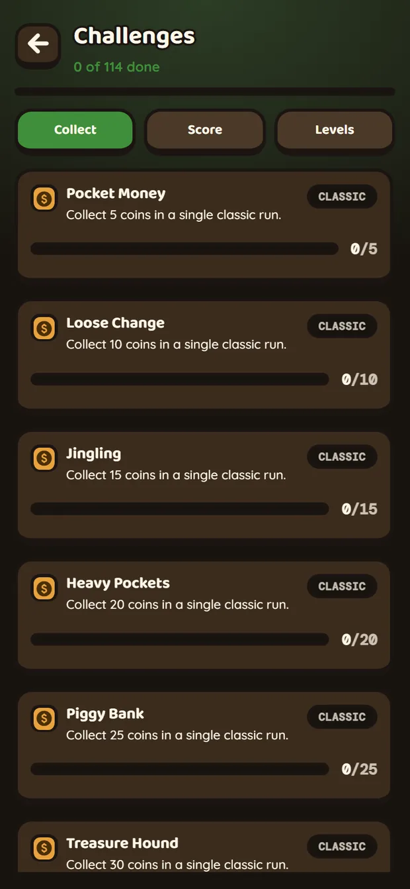
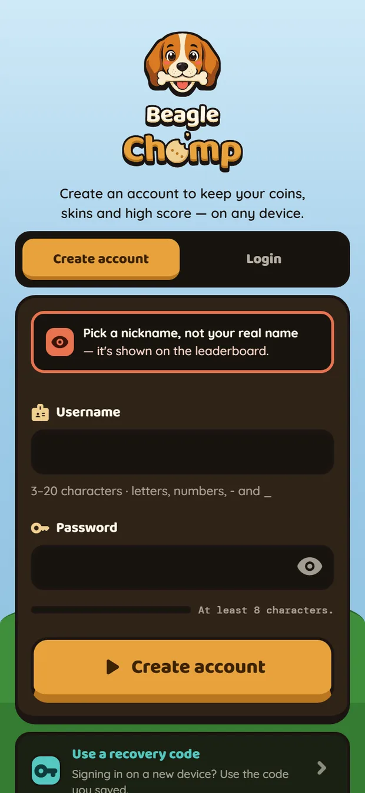
</div>

**Characters are sculpted, not modelled.** They are built from swept solids, revolved
profiles and per-triangle material groups ([`beagleSculpt.ts`](src/render/beagleSculpt.ts)),
measured off reference images by an image-to-three.js pipeline and then hand-tuned until
they read at the size a player actually sees them.

**Surfaces are painted at runtime.** Walls and floors are drawn to a canvas and tile
seamlessly ([`wallTexture.ts`](src/render/wallTexture.ts), [`floorTexture.ts`](src/render/floorTexture.ts)).
The park's gravel walks and the city's road markings follow the real corridors of
whichever maze you are on.

**Sound is synthesis.** About 1,600 lines of hand-written Web Audio ([`sound.ts`](src/ui/sound.ts),
[`ambience.ts`](src/ui/ambience.ts)). Each world's ambient bed is deliberately pitched outside
the frequency band of the biscuit chomp, so the two can never mask each other.

**The game logic has no idea three.js exists.** `src/game/*` is pure TypeScript (grid,
tile-stepping movement, enemy AI, the state machine) with a hard rule that it never imports
`three`. That is what lets `npm run test` run the *real* modules in Node, with a
pathfinding bot that has to clear all 36 boards to 100% before the suite passes.

**Draw calls are the budget, not triangles.** The whole maze is one `InstancedMesh`. The
neighbourhood around it (hundreds of houses, hedges, trees and flower beds) is merged by
material into ~14 draw calls and culled to the camera's actual ground footprint, which cuts
a phone's surround geometry by about 65%.

**It ships with its own 3D editor.** `npm run editor` opens a dev-only workbench over the
real meshes: part tree, transform gizmo, multi-select, animation timeline, undo, glTF
import/export, and **it writes changes back into the source files** as three.js code. It
never ships to players.

## Tech

**Frontend:** three.js r169 (WebGL) · TypeScript (strict) · Vite · vite-plugin-pwa
**Backend:** Hono · Node 22 · Postgres (`pg`, no ORM) · argon2id · zod
**Tests:** 50+ suites, pure logic ones that run in Node plus Playwright ones that drive the real app
**Hosting:** Cloudflare Pages (frontend) · Docker on a VPS via Dokploy (API)

No physics engine, no post-processing, no asset loader. Movement is tile-stepping on a
grid; 1 world unit = 1 maze tile.

## Running it locally

```bash
npm install
npm run dev          # the game at localhost:5173
npm run test         # the headless logic suites (no browser, no database)
npm run build        # typecheck + production build
```

The game requires sign-in, so `npm run dev` alone will stop at the login screen. For the
full stack:

```bash
cp .env.example .env         # VITE_API_URL=http://localhost:3001
docker compose up db api     # Postgres + the API (migrations run on start)
npm run dev                  # in a second terminal
```

Everything in Docker instead: `docker compose --profile full up`.
See [`server/README.md`](server/README.md) for the API on its own.

<details>
<summary><b>Dev-only pages, tests and project layout</b></summary>

### Dev-only pages

| Page | What it is |
|---|---|
| `/editor/` | The mesh, theme, prop and balance workbench (`npm run editor`). |

None of them are build inputs, so none of them ship.

### Tests

```bash
npm run test               # the pure suites: maze validation, the sim, and the rest
npm run validate           # maze connectivity and reachability
npm run sim                # a pathfinding bot must clear all 36 boards
npm run test:editor        # the editor suites (Playwright)
npm run test:menu-ui       # one of the suites that drives the real app
```

Anything touching `src/game/{grid,movement,ghostAI}.ts` or the maze data has to pass
`npm run test` before it counts as done. Changing `config.ts`, `mazes.json`, `journey.ts`
or `challenges.ts` also means `npm run sync` inside `server/`: the score validator's
constants are generated from the real game modules, and drift means honest runs start
getting rejected.

### Layout

```
src/game/      pure logic, never imports three. Grid, movement, AI, state, config,
               36 mazes, cosmetics, themes, the Journey ladder, 114 challenges
src/render/    three.js: scene, board, characters, props, surround, the art direction
src/ui/        DOM chrome: HUD, shop, leaderboard, challenges, sound + ambience
src/input/     keyboard · swipe · D-pad · thumbstick
src/editor/    the dev-only workbench (nothing in the game imports from it)
server/        the API: Hono + Postgres + argon2id, own Dockerfile and migrations
admin/         the metrics portal (its own build, its own Pages project)
scripts/       the test suites plus ~100 measuring instruments and review sheets
docs/          architecture, game design, the brand kit and the README media
```

</details>

## Documentation

- [`docs/ARCHITECTURE.md`](docs/ARCHITECTURE.md): the layer rules, the coordinate system, the editor, the render pipeline
- [`docs/GAME_DESIGN.md`](docs/GAME_DESIGN.md): entities, scoring, AI, progression, the economy
- [`docs/brand/BRAND_GUIDELINES.md`](docs/brand/BRAND_GUIDELINES.md): the logo, its lockups, colours and how (not) to use them
- [`server/README.md`](server/README.md): the API, its migrations, its observability

## Built with Claude Code

This whole game was built in collaboration with [Claude Code](https://claude.com/claude-code).

## License

The code is [MIT](LICENSE). Use it, learn from it, build on it.

Two things are not covered by it:

- **The Beagle Chomp name and logo** (`docs/brand/`, `public/brand/`, the app icons) are the
  game's identity. Please don't use them for your own project.
- **The reference imagery** some characters were modelled from: watermarked stock
  photographs kept out of the repository entirely (`.img2threejs/` is gitignored). No pixel
  of any of them is used as colour or texture. Every mesh here is original geometry.
